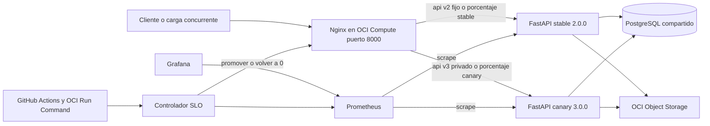

# Gestor de inventario

API para administrar inventario entre varios almacenes.

## Canary Deployment en OCI

La entrega canary incorpora stable v2 y canary v3 en OCI Compute, con Nginx,
Prometheus, Grafana y una puerta de promoción y rollback. La operación completa,
los comandos y límites están en [la guía canary](docs/canary-operacion.md).

La [validación real en OCI](docs/evidencias-canary/README.md) incluye promoción
hasta 100 por ciento, aborto automático con inventario intacto, Grafana autenticado
y ejecución del workflow manual. CI aprobó 176 pruebas y 93,33 por ciento de cobertura.



`/api/live/*` distribuye peticiones usando `split_clients` y un identificador
aleatorio por petición. `/api/v2/*` conserva stable; `/api/v3/*` permite pruebas
de canary con `X-Api-Key`. En la ruta live, `X-Canary: true` con clave válida
fuerza una prueba interna incluso con público en 0. No se fijan sesiones.
Las respuestas de API identifican versión, track y revisión mediante cabeceras.

| Etapa | Público canary | Horneado mínimo | Máximo de espera |
| --- | --- | --- | --- |
| 0 | 0 por ciento | 60 segundos | 300 segundos |
| 1 | 10 por ciento | 120 segundos | 300 segundos |
| 2 | 50 por ciento | 120 segundos | 300 segundos |
| 3 | 100 por ciento | 120 segundos | 300 segundos |

Cada etapa exige 1000 solicitudes por track en una ventana de 60 segundos,
500 solicitudes públicas y SLO de errores, latencia, CPU, memoria y negocio.
La política versionada decide promoción, pausa o aborto. Una regresión fuerza
0 público canary y verifica 30 consultas stable; las muestras insuficientes
jamás aprueban una etapa. La imagen se construye una vez y todas las etapas
usan el mismo identificador SHA256.

Expand/Contract: v3 amplía la respuesta de inventario con `estado_stock` y
`unidades_reponer`, sin cambiar columnas, colas, cachés ni claves de objetos.
V2 mantiene su contrato. Canary no ejecuta DDL. La fase Contract se aplaza
hasta retirar v2 y cerrar la ventana de rollback; volver a stable no requiere
restaurar la base ni borrar los movimientos aceptados.

El workflow manual `Canary en OCI` ofrece `install`, `promote`, `regression`
y `rollback` sobre la VM existente. Una instalación comienza en 0 y guarda
backup PostgreSQL. El tablero está en `/grafana/d/inventory-canary/` con login.
La [guía de sustentación](docs/canary-sustentacion.md) cubre ambos escenarios.

## Entrega 3: infraestructura con Terraform

La [guía de Terraform y OCI](terraform/readme.md) explica cómo crear Compute,
VCN, Object Storage y Vault, instalar esta API y PostgreSQL, validar el resultado
y eliminar la demo. El nuevo pipeline `Infraestructura y API en OCI` es manual;
`Validacion OCI` comprueba código, Terraform y Docker sin credenciales de nube.
Los pipelines anteriores de Railway y Render se conservan.

## Object Storage V2

`GET /api/v2/storage` lista el bucket con paginación y filtro opcional por prefijo.
`POST /api/v2/storage` guarda JSON en OCI y `GET /api/v2/storage/{trace_id}` lo
recupera. Reutiliza la API key y trazabilidad existentes. Consulta la
[guía de Object Storage](docs/object-storage.md) para configurar autenticación,
crear el bucket, probar las rutas y ejecutar las pruebas sin credenciales OCI.

## Versionamiento

La API original se conserva sin prefijo (`/skus`, `/almacenes`, `/movimientos`
e `/inventario/query`). La versión 2 expone las mismas operaciones bajo
`/api/v2` y añade trazabilidad e integración externa.

`GET /api/v2/health` responde:

```json
{
  "status": "ok",
  "version": "2.0.0",
  "service": "inventario-u"
}
```

## Objetivo

Construir una API RESTful con persistencia real que permita administrar productos, almacenes y movimientos de inventario. El proyecto incluirá el método HTTP `QUERY` para realizar consultas complejas de inventario sin modificar datos.

## Entidades

### SKU

Representa un producto identificable en el inventario.

- Código SKU
- Nombre
- Descripción
- Stock mínimo

### Almacén

Representa la ubicación física donde se guardan productos.

- Nombre
- Ubicación

### Movimiento

Registra una entrada, salida o ajuste de un SKU en un almacén.

- SKU
- Almacén
- Tipo de movimiento
- Cantidad
- Fecha y motivo

## Ejecución local

Para iniciar la estructura inicial de FastAPI:

```bash
uv sync
uv run fastapi dev app/main.py
```

La guía con PostgreSQL y Docker se completará más adelante. El comando final será:

```bash
docker compose up --build
```

## Configuración de base de datos

1. Copia `.env.example` como `.env`.
2. Ajusta `DATABASE_URL` con las credenciales de tu PostgreSQL local.
3. Define `DEPORTBACK_API_URL` y `FASTIFY_API_URL` con las URL base de los
   servicios de los compañeros.
4. Define `TEAM_API_KEY` solo cuando el equipo haya acordado una clave compartida.
   Si está vacía, la API queda abierta para desarrollo local.
5. No subas `.env` al repositorio: contiene valores específicos de cada ambiente.

## Integración V2 y trazabilidad

`GET /api/v2/integracion` combina un inventario local con un deportista y un
artículo obtenidos en tiempo real desde sus APIs propietarias. Requiere los
parámetros `sku_id`, `almacen_id`, `deportista_id` y `articulo_id`.

```bash
curl "http://127.0.0.1:8000/api/v2/integracion?sku_id=1&almacen_id=1&deportista_id=<uuid>&articulo_id=1" \
  -H "X-Trace-Id: demo-123"
```

La respuesta conserva o genera `X-Trace-Id`, lo devuelve en el encabezado y
en el cuerpo, y lo reenvía a ambos servicios externos. Si alguno falla o se
agota el tiempo de espera, el endpoint responde `502` con el servicio y la
causa; no persiste los datos externos.

Mientras los contratos propietarios V2 de los compañeros están pendientes, la
integración consulta temporalmente `/deportistas/{id}` y `/articulos/{id}`.
Estas rutas no se cambiarán hasta que los endpoints equivalentes bajo
`/api/v2` estén disponibles y no introduzcan ciclos.

Cuando `TEAM_API_KEY` está configurada, las rutas funcionales V1 y V2 requieren
el encabezado `X-Api-Key`. Los endpoints `/health` y `/api/v2/health` siempre
permanecen públicos para probes. Las llamadas externas propagan tanto
`X-Api-Key` como `X-Trace-Id`.

## Consulta de inventario con HTTP QUERY

La API admite el método HTTP `QUERY` en `/inventario/query` y
`/api/v2/inventario/query`. Este método solo consulta: no crea, modifica ni elimina datos.

Envía un body JSON con filtros opcionales:

```json
{
  "sku_id": 1,
  "almacen_id": 1,
  "tipo": "salida",
  "fecha_desde": "2026-08-01T00:00:00",
  "fecha_hasta": "2026-08-31T23:59:59",
  "solo_stock_bajo": false
}
```

El resultado muestra el stock total disponible de cada SKU por almacén. Si filtras por tipo o fecha, se muestran únicamente las combinaciones que tengan movimientos que coincidan con ese filtro, pero el stock sigue calculándose con todo el historial.

```bash
curl -X QUERY http://127.0.0.1:8000/api/v2/inventario/query \
  -H "Content-Type: application/json" \
  -d "{\"almacen_id\": 1, \"solo_stock_bajo\": true}"
```

Puedes verificar los formatos aceptados con:

```bash
curl -X OPTIONS -i http://127.0.0.1:8000/api/v2/inventario/query
```

La respuesta incluye el encabezado `Accept-Query: application/json`.

## Pruebas automatizadas

Las pruebas usan una base de datos aislada indicada por `TEST_DATABASE_URL`. Crea primero esa base en PostgreSQL y verifica que su nombre sea diferente de la usada en `DATABASE_URL`.

```bash
uv sync --group dev
uv run python scripts/create_test_database.py
uv run pytest
```

La cobertura se muestra al terminar y debe ser al menos 85%. Para el futuro pipeline de pruebas se podrá permitir un mínimo de 60%, mientras que producción exigirá 85%.

## Docker

Docker Compose levanta dos servicios: la API y PostgreSQL. La base de datos se mantiene en el volumen `postgres_data`.

```bash
docker compose up --build
```

Cuando ambos contenedores estén listos, comprueba la API:

```bash
curl http://127.0.0.1:8000/api/v2/health
```

Para detener los contenedores:

```bash
docker compose down
```
