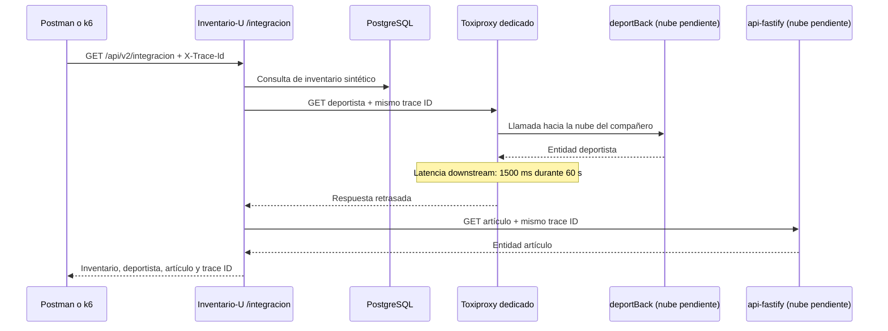

# Seguimiento 4: Ingeniería del Caos

Estado: base local en `feat/chaos-v4`, todavía no es una entrega terminada.
La fecha de la rúbrica es el 18 de noviembre de 2026, antes de clase.

## Alcance y pendientes del grupo

Se conserva Inventario-U, PostgreSQL, sus clientes de integración, trazabilidad,
OCI, Nginx, Prometheus, Grafana y los controles canary. No se elimina ni
reconstruye la infraestructura de las entregas anteriores. El flujo experimental
no necesita agregar colas, caché ni escritura en Object Storage.

| Responsabilidad propuesta | API | Nube | Fallo | Métrica objetivo | Estado |
| --- | --- | --- | --- | --- | --- |
| Coordinador: Alejandro | Inventario-U | Oracle OCI | Latencia saliente hacia deportBack | p95 E2E | Propuesta, falta acuerdo |
| Compañero A | deportBack | Por confirmar | Dependencia indisponible | Por acordar | Repositorio y URL pendientes |
| Compañero B | api-fastify | Por confirmar | Agotamiento de recurso | Por acordar | Repositorio y URL pendientes |

Falta confirmar quién tendrá Kubernetes. La API completa de ese integrante
debe tener al menos dos réplicas, liveness/readiness y requests/limits. Un
simulador local no cuenta como una de las APIs completas ni como nube real.

## Flujo existente y punto de inyección propuesto



El flujo actual consulta secuencialmente las dos dependencias desde Inventario-U.
El grupo debe confirmar este contrato de coordinación y las rutas propietarias
antes de afirmar que cumple el recorrido real entre las tres nubes.

El radio de impacto se limita a un proxy `chaos-*` aislado, con upstream
verificado y sin toxics previos. Solo pasa por él la dependencia elegida del
coordinador experimental. No cambiar la URL de una API usada por otros equipos.

## Rondas, hipótesis y límites

Hipótesis propuesta: con `chaos/load/profile.json`, al inyectar 1500 ms en la
respuesta de una dependencia durante 60 s, p95 E2E permanece bajo el umbral U
acordado. El gate también exige al menos 100 peticiones en 30 s y 99% de flujos
HTTP 2xx. U es una variable obligatoria: no se inventa una línea base numérica.

1. Medir y guardar el estado estable sin fallos. Registrar p95, éxito,
   throughput, volumen y los trace IDs del flujo; acordar U con el grupo.
2. R0: API con `RESILIENCE_MODE=baseline`. Conserva el timeout previo de 5 s.
   Ejecutar el experimento y guardar la refutación si ocurre. No declarar una
   refutación si el resultado real no la demuestra.
3. Diagnosticar la causa usando métricas, logs y trazas del mismo intervalo.
4. R1: reiniciar la API aislada con `RESILIENCE_MODE=protected`. Repetir carga,
   fallo, duración, datos e instrumento exactamente iguales.
5. Comparar valores y variación porcentual. Si R1 no cumple, la hipótesis sigue
   refutada y hay que corregir la protección; no convertir un 502 rápido en éxito.

Dos patrones están implementados en los clientes de Inventario-U:

- Timeout por dependencia: 0.5 s por defecto, configurable entre 0.05 y 5 s.
  Se mide por las operaciones de HTTPX; no es un plazo total garantizado del
  flujo completo. Las dos dependencias y PostgreSQL también consumen tiempo.
- Circuit breaker: abre después de tres fallos de disponibilidad consecutivos,
  espera 10 s y admite una sola prueba de recuperación. Un 4xx no abre el
  circuito. No se agregan reintentos. Su estado es local a cada proceso/réplica.

Se expone `inventory_dependency_circuit_state` (0 cerrado, 0.5 semiabierto,
1 abierto). El circuito y el timeout protegen recursos y acortan esperas, pero
por sí solos no garantizan 99% de flujos completos durante una caída. Si R1
falla esa condición, evaluar y justificar otra mejora; no hay resultados
antes/después publicados todavía.

## Perfil reproducible k6

`chaos/load/flow.js` carga siempre el mismo `profile.json`:

| Escenario | Inicio | Duración | Llegadas | VUs preasignados/máximos |
| --- | --- | --- | --- | --- |
| warmup | 0 s | 30 s | 10/s | 20/20 |
| measurement | 30 s | 120 s | 20/s | 20/20 |
| recovery | 150 s | 30 s | 10/s | 20/20 |

Cada escenario admite 5 s de gracia. Se declaran 20 VUs por escenario y un
máximo global de 40 durante el solapamiento de los cambios. El perfil dura
180 s más un máximo de 5 s de gracia. Si faltan VUs y se descartan iteraciones,
k6 falla el umbral `dropped_iterations`; conservar ese dato en la comparación.

El script exige IDs sintéticos, clave por entorno, R0/R1 y confirmación de
ventana. Propaga un trace ID distinto por iteración y comprueba que la respuesta
contiene las tres entidades. Guarda perfil y métricas en
`chaos/results/k6-R0.json` o `k6-R1.json`; el directorio no se versiona.
No se considera que Postman sustituya al generador de carga reproducible.

## Experimento declarativo y ejecución

Se usa Chaos Toolkit con un provider Python que modifica Toxiproxy. Ambos son
herramientas permitidas por la rúbrica. El interruptor propio existente de la
API canary se conserva y ahora admite `duration_seconds` entre 1 y 600, con
caducidad predeterminada de 180 s; sigue requiriendo habilitación explícita y
clave válida. Sus errores conservan `X-Trace-Id`.

Instalar la herramienta opcional, sin incluirla en la imagen de producción:

```powershell
uv sync --frozen --group dev --group chaos
uv run --frozen --group chaos python -m chaostoolkit --no-version-check --no-log-file validate chaos/experiments/outbound-latency.json
```

Para validar offline con valores sintéticos, incluyendo la carga sin ejecutarla:

```powershell
uv run --frozen --group chaos python -m scripts.validate_chaos --k6
```

Ese comando usa `inspect`, no `run`, y no consulta las APIs ni inyecta fallos.

Primero cargar en el entorno los valores de `chaos/.env.example`. Ese archivo
no se carga automáticamente. Una ventana válida requiere timestamps con zona,
`CHAOS_WINDOW_ACK=GROUP_SYNTHETIC_ONLY`, IDs sintéticos y un `CHAOS_RUN_ID`
hexadecimal único de 32 caracteres. Los controles de Toxiproxy y Prometheus
solo aceptan loopback; para otra máquina usar un túnel o ejecutar allí, nunca
publicar esos puertos administrativos.

Crear previamente un proxy dedicado llamado `chaos-deportback` con el upstream
del compañero y configurar el cliente del coordinador aislado para usarlo.
Para HTTPS conservar hostname, SNI y validación de certificados: no desactivar
TLS para hacer funcionar un proxy. Esa adaptación está pendiente de conocer
las URLs reales.

Iniciar el perfil y esperar muestras estables. Con una carga común en marcha,
ejecutar el experimento durante su ventana y conservar el journal:

```powershell
New-Item -ItemType Directory -Path chaos/results -Force
k6 run chaos/load/flow.js
# En otra terminal, tras estabilizar el flujo y sin cambiar el perfil:
uv run --frozen --group chaos python -m chaostoolkit --no-version-check --no-log-file run chaos/experiments/outbound-latency.json --journal-path chaos/results/journal-R0.json
```

Para R1 cambiar el modo del proceso, la etiqueta de ronda y el run ID. Los
parámetros del experimento, los umbrales y el perfil deben permanecer iguales.
No publicar resultados, secretos ni journals sin revisarlos.

## Aborto y reversión

Chaos Toolkit no debe inyectar si falla el estado estable inicial. Se rechazan
ventanas vencidas, menos de 90 s disponibles para iniciar la inyección, targets
no dedicados, upstream distinto, toxics existentes o métricas vacías/no finitas.
Después de los 60 s se vuelve a evaluar el objetivo y se ejecuta el rollback.
No se promete detección continua de degradación durante esa pausa de 60 s.

La reversión elimina únicamente el toxic del run ID actual y verifica su
ausencia, incluso si venció la ventana. No usa `/reset` ni toca los demás
proxies. Una API de control inaccesible deja la reversión sin confirmar y debe
registrarse como fallo operativo, no como recuperación exitosa.

Limitación pendiente: Toxiproxy no tiene aquí un watchdog independiente del
proceso del experimento. Antes de la primera ejecución real en nube hay que
probar el aborto completo y añadir una protección que
sobreviva a la muerte del controlador. También debe corregirse el apagado de
la VM para no depender del portátil. No iniciar recursos cloud con el guard
local anterior como única protección.

## Comprobado y pendiente

Comprobado localmente: timeout real frente a una dependencia HTTP lenta de
loopback, propagación de trace ID, apertura y recuperación del circuito,
exclusión de respuestas tardías, fallos con caducidad y validaciones del gate.
Las pruebas unitarias de providers usan respuestas controladas. Además,
`scripts/verify_toxiproxy.py` verificó Toxiproxy 2.12.0 real contra un nginx
sintético en una red Docker temporal: aproximadamente 15 ms sin fallo, 1500 ms
con el toxic y 31 ms después de eliminarlo y verificar su ausencia. Este es
un chequeo de transporte/reversión, no un resultado R0/R1 del flujo completo
ni evidencia entre tres nubes. Los contenedores y la red se eliminaron al acabar.

```powershell
uv run --frozen --group chaos python -m scripts.verify_toxiproxy
```

La suite completa pasó localmente: 207 pruebas, 94.21% de cobertura de `app`.
La base de PostgreSQL usada en las pruebas fue exclusiva del proyecto y quedó
detenida después de ejecutarlas. El experimento pasó la validación real de
Chaos Toolkit y k6 pudo inspeccionar el perfil sin enviar carga. El workflow
local aún necesita publicarse y ejecutarse en GitHub para tener evidencia CI.

Pendientes para completar la rúbrica:

- Repositorios, proveedores, URLs, IDs y ventana autorizada de los compañeros.
- Elegir y verificar el despliegue Kubernetes de la API completa.
- Acordar propietarios, métricas e hipótesis de indisponibilidad y recursos.
- Instrumentar el flujo completo con trazas consultables y logs estructurados.
- Añadir el tablero específico de rondas con las ventanas de inyección.
- Ejecutar las dos rondas reales, comprobar recuperación y aplicar mejoras
  adicionales si el gate sigue fallando.
- Ejecutar un chaos gate real desde CI/CD. El workflow de validación local
  solo verifica código/contratos, no satisface esa evidencia cloud.
- Elaborar el informe de máximo seis páginas con datos reales, capturas,
  variación porcentual, hallazgos y backlog. Declarar uso de IA y propuestas
  descartadas. La entrega de Defensa en Profundidad tendrá un informe distinto.
- Preparar sustentación individual y publicar tag/release v4.0.0 al completar
  la evidencia. La versión 3.0.0 actual no se reetiqueta por este borrador.

Referencias técnicas:

- https://chaostoolkit.org/reference/api/experiment/
- https://chaostoolkit.org/reference/usage/run/
- https://github.com/Shopify/toxiproxy
- https://grafana.com/docs/k6/latest/using-k6/scenarios/executors/constant-arrival-rate/
